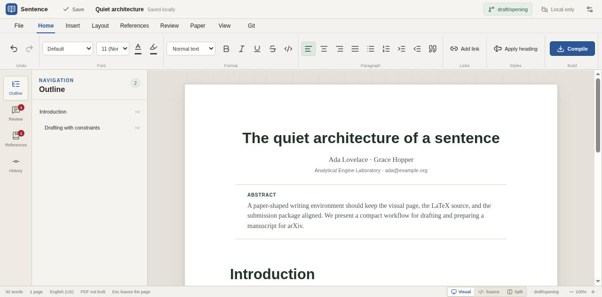

# Sentence

A desktop LaTeX editor with a Word-style ribbon. You write on a page, not in
markup — Sentence keeps a readable, compilable `.tex` in sync and builds papers,
books and notes through a bundled Tectonic engine.



## Why

Word is comfortable and cannot typeset maths. LaTeX typesets anything and is
miserable to write. Sentence keeps the Word-shaped surface (ribbon, page,
navigation pane, review marks) and the LaTeX substance (a real `.tex` file you
can hand to a journal).

The project on disk is a plain folder:

```
document.tex      the source of truth — readable, compilable outside the app
sentence.json     the visual model and settings
references.bib    bibliography
.sentence/        review state, build output, TeX cache
.git/             real git, with a visual history and GitHub sync
```

## What works

- **Editing** — Tiptap page with headings, lists, tables (contextual toolbar:
  rows, columns, merge, caption), links, images, footnotes, citations,
  cross-references, maths (KaTeX), comments and tracked changes.
- **Two-way source sync** — Visual ⇄ LaTeX ⇄ Split. Edits survive the round trip,
  including nested lists, tables, `\href`, `\ref`, `\cite`, `equation` vs
  `equation*`, and footnotes with braces in their text.
- **Find & replace**, Word keyboard shortcuts (`Ctrl+F/H/K`, `Ctrl+Shift+7/8`,
  `Ctrl+1/2/5`, Tab indent), zoom, print, focus view.
- **Review** — comments with replies and resolve, tracked edits with accept /
  reject, per-change history.
- **Compile** — Tectonic sidecar, PDF preview, diagnostics with file/line,
  PDF and arXiv source-package export (plus HTML and Markdown).
- **Git** — libgit2 history, diff, branches, commits; GitHub device-flow login and
  repository publishing.
- **Themes** — Classic / Modern / Compact style galleries that set the LaTeX
  preamble, not just the CSS.

## Document types

| Class | Structure | Notes |
|---|---|---|
| `article` | section → subsection → … | arXiv papers, notes, one-pagers |
| `report` | chapter → section → … | reports, theses |
| `book` | part → chapter → section → … | books, with front matter and appendices |
| `letter` | unnumbered body | letters |

Two-column layout, paper size, margins, font size, line spacing and paragraph
style are settings that flow into the preamble and back.

## Zotero

References come from your Zotero library, not a second database. In Zotero 7 open
**Settings → Advanced** and tick **"Allow other applications on this computer to
communicate with Zotero"**, then leave Zotero running.

In Sentence: **References (sidebar) → Add → Search your Zotero library**. Picking a
result writes a complete BibTeX entry — journal, volume, number, pages, DOI,
publisher, ISBN/ISSN, abstract — into `references.bib`, with a `lastname+year+word`
key that is deduped against what is already there. The request goes through Rust
(`zotero_search`) because Zotero's local API sends no CORS headers, so a webview
fetch would never reach it.

`node qa/mock-zotero.mjs` serves a stand-in library on `127.0.0.1:23119` for testing
(`ZOTERO_LIVE=1 cargo test --lib zotero` exercises the real request).

## Build and run

Requirements: Node 20+, Rust (stable), and the Tauri 2 system dependencies.

```bash
npm install
bash scripts/fetch-tectonic.sh          # Linux/macOS sidecar
npm run dev                              # UI in a browser (desktop actions stubbed)
npm run desktop:linux                    # full desktop app (Linux)
```

On Windows use `npm run desktop` / `npm run desktop:build` (PowerShell scripts in
`.tools/`, WebView2). On Linux the scripts set `WEBKIT_DISABLE_DMABUF_RENDERER=1`
— WebKitGTK aborts on Wayland without it. Release build: `npm run
desktop:linux:build`, binary at `src-tauri/target/release/sentence`.

Tests:

```bash
npx tsc -b        # real typecheck (`npm run check` is a no-op, see AGENTS.md)
npm test          # Vitest, LaTeX round trips and pure logic
cargo test --manifest-path src-tauri/Cargo.toml
```

## Architecture

Tauri 2 shell, React 19 + Tiptap 3 frontend, Rust backend.

- `src/lib/latex.ts` — `documentToLatex` / `latexToDocument`, the two-way
  translation that everything else depends on. Every document-model change keeps
  both directions and its round-trip tests in sync.
- `src/lib/tauri.ts` — the whole backend surface, typed; stubbed in the browser.
- `src-tauri/src/{project,latex,git,github,arxiv}.rs` — one module per domain;
  `latex.rs` runs the Tectonic sidecar with `--untrusted`.
- `src/editor/` — Tiptap extensions and the paginated surface.

## How it is built

Most of the bug fixing and feature work in this repository was produced by an
autonomous loop, supervised by a human: a Playwright gate drives the app in
Chromium, an explorer agent writes its own probes for untested areas, work orders
live in `qa/roadmap.json`, and a coding agent implements each item on a branch.
Nothing merges unless `tsc -b`, the unit tests and the gate pass. See
`qa/README.md` and `docs/PRODUCT.md`.

## License

MIT — see [LICENSE](LICENSE).
